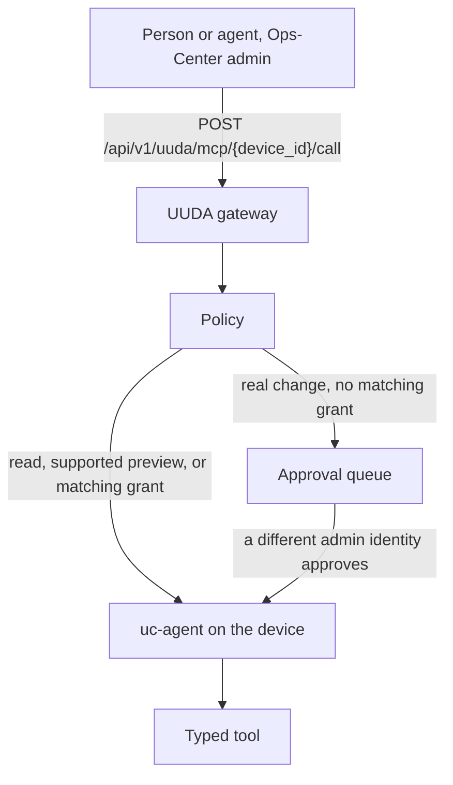
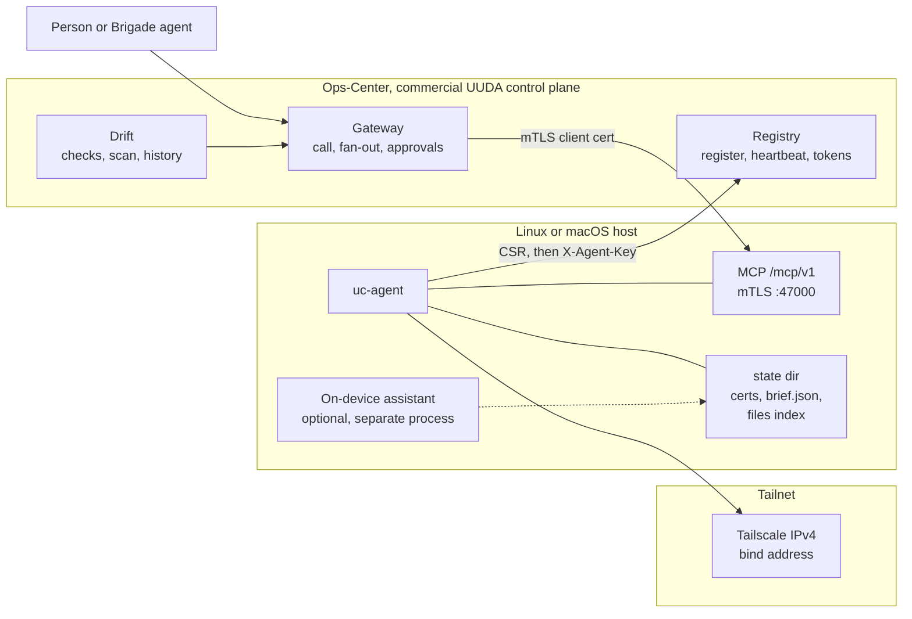

<p align="center">
  <strong>UUDA</strong><br>
  Uniform Unicorn Device Agent
</p>

<p align="center">
  A Rust daemon on each Linux or macOS machine. People and agents call typed tools over mutual TLS.
</p>

<p align="center">
  <a href="LICENSE-APACHE"></a>
  <a href="agent/Cargo.toml"></a>
  <a href="agent/rust-toolchain.toml"></a>
  <a href="#built-for-agents"></a>
  
  
</p>

<p align="center">
  <a href="#quick-start">Quick start</a> ·
  <a href="#features">Features</a> ·
  <a href="#built-for-agents">Agents</a> ·
  <a href="#architecture">Architecture</a> ·
  <a href="#part-of-unicorn-commander">Suite</a>
</p>

The crates in this repository are version **0.2.0**. [CHANGELOG.md](CHANGELOG.md) records the 0.1.0 walking skeleton (2026-04-26), the 0.2.0 gateway, policy, tenancy, and drift release (2026-06-25), and later unreleased work that is still on the same version.



<p align="center"><em>A tool call through the commercial control plane. Reads run. Policy can allow, queue, or deny a change; a queued action needs approval from a different admin identity.</em></p>

## What is UUDA?

UUDA is the device agent for a fleet you run yourself. `uc-agent` is one binary. It registers with the UUDA control plane, heartbeats, and serves a typed [MCP](https://modelcontextprotocol.io) tool surface over mutual TLS on that machine's tailnet address.

You use it on Linux and macOS servers and workstations. Phones, tablets, and mobile-device management are outside what this agent does. The daemon never calls a model. An assistant you run on the workstation, if you run one, picks up a brief from disk. Fleet callers can reach the device through the commercial control plane provided here as an [Ops-Center](https://github.com/Unicorn-Commander/Ops-Center) patch: registry, policy, audit, and the gateway. That plane is proprietary and can hold a mutating call for approval by a different admin identity.

## Features

- **Eighteen typed tools** on one mTLS listener, so a caller asks for `system.health` or `package.install` instead of a shell session.
- **Preview by default** on `package.install` and `messages.send` when called directly on the device. Through the gateway, a real mutation is queued for a different admin identity to approve, unless a matching grant allows it.
- **Fleet probes with a deadline.** `disk.smart`, `zfs.status`, `update.status`, and `container.images` are read-only. Each external command times out (20 seconds unless the caller sets a lower or higher bound, hard cap 300 seconds).
- **Headless and squad, same binary.** Servers leave `has_local_agent` off. A workstation can store a brief for an on-device assistant and report that assistant's last status.
- **Opt-in file search** (SQLite FTS5) and, on macOS only, an opt-in Messages bridge. Both stay off until the config turns them on.
- **Device identity and heartbeat retries.** The process generates a key, sends a CSR, and stores the signed certificate, the CA chain, and an agent key. Heartbeats send that key and retry from an in-memory queue capped at 1,000 payloads, dropping the oldest when full.
- **Install paths that match the service manager.** `agent/install.sh` lays down systemd or launchd. A `.deb` can be built from a Linux binary; it does not start a stopped service, but can restart an active service during an upgrade.
- **Desired-state checks and governed remediation.** Control-plane scans compare read-tool results with declared expectations. Remediation goes through the gateway's policy and approval queue.

### Registration and heartbeat

On first start, with no `registration.toml` yet, the agent builds a CSR, posts it to `{control_plane.base_url}/api/v1/uuda/register` with the bootstrap token, and writes `cert.pem`, `key.pem`, and `ca-chain.pem`. After that it heartbeats `device_id`, `agent_version`, and process uptime to `/api/v1/uuda/heartbeat` with header `X-Agent-Key`. The default interval is 30 seconds. The listener binds to `tailscale ip --4` unless `UC_AGENT_LISTEN_IP` is set, on port **47000** by default.

The bootstrap token is bound to the hostname reported by `hostname` or overridden by `UC_AGENT_HOSTNAME`. The device certificate has that hostname as its DNS subject alternative name. Use that name in a verifying client's URL and resolve it to the device's address.

The whole listener, including `GET /healthz` and `GET /version`, requires a client certificate chained to the UUDA CA. A curl with no certificate fails in the handshake.

### Health, metrics, logs, and service status

`system.health` returns uptime, load, memory, disks, and CPU temperature from supported Linux thermal sensors when available. `system.metrics` serves a 1 Hz ring buffer: the default window is 300 seconds, the maximum window is 3600, and series are capped at 500. `system.logs` reads the systemd journal for a unit on Linux, and `log show` by subsystem on macOS (default 200 lines, hard cap 10,000). `service.status` asks systemd or launchd for state, enabled flag, pid, and a short log tail. These four are read-only.

```bash
curl --cert '<client-cert>.pem' --key '<client-key>.pem' --cacert '<ca-chain>.pem' \
  -H 'content-type: application/json' \
  -H 'accept: application/json, text/event-stream' \
  -d '{"jsonrpc":"2.0","id":1,"method":"tools/call","params":{"name":"system.health","arguments":{}}}' \
  "https://<device-host>:47000/mcp/v1"
```

### Packages, with a dry-run default

`package.install` selects Homebrew automatically on macOS when `/opt/homebrew/bin/brew` or `/usr/local/bin/brew` exists, or `apt-get` on Linux when `/usr/bin/apt-get` exists. On the device, `dry_run` defaults to **true**: a successful preview returns a change set without installing. Pass the boolean `false` to request installation. The gateway treats a missing `dry_run` as a real change and holds it unless a matching grant allows it; see [Built for agents](#built-for-agents).

```json
{ "name": "package.install", "arguments": { "name": "<package>", "dry_run": true } }
```

`backend` accepts `auto`, `apt`, or `brew`.

The supplied systemd unit makes system directories read-only (`ProtectSystem=strict`), so real apt installs need a service override that permits the package manager's writes. The Homebrew backend runs as the owner of the Homebrew executable and ignores the optional version pin.

### Disks, ZFS, updates, and containers

These four observers do not repair anything. Their external commands each have a deadline; a probe can run several commands in sequence, and direct filesystem reads are outside that timeout.

| Tool | What it reports | Availability signal |
|---|---|---|
| `disk.smart` | Per-disk SMART raw counters. Status comes from those counters. The overall PASSED/FAILED bit is reported beside them and is not an input. | `smartctl_available: false` off Linux |
| `zfs.status` | Pool capacity, vdev errors, scrub state, and `suspended` as its own flag. It runs `zpool list` and `zpool status` only. | `zfs_available: false` |
| `update.status` | Apt refresh age, upgradable and security counts, last recognized unattended-upgrades outcome, dpkg lock holders and their process ages, D-state processes, reboot-required, held packages. Process age is an estimate, not the measured lock duration. | `apt_available: false` off Linux or when neither `/usr/bin/apt-get` nor `/usr/bin/apt` exists |
| `container.images` | Containers visible to the Docker CLI: tag, digest, age, restart policy, whether each is restarting now, health. It does not contact a registry. | `docker_available: false` when the CLI or daemon is unavailable |

### Squad mode: briefs without a model in the daemon

`agent.has_local_agent` defaults to false. `agent.report` then returns a headless summary without reading a local assistant's report. `agent.brief` writes the prompt, context, and tasks to `{state_dir}/brief.json` regardless of that flag. With the flag true, `agent.report` reads the last brief plus `{state_dir}/report.json`, which the on-device assistant writes. `uc-agent` does not start that assistant.

Through the gateway, `agent.brief` is a real mutation: it has no dry-run flag, so the call is held for approval unless a grant covers it.

### File search, off until you enable it

`files.search`, `files.index`, and `files.status` use a local SQLite FTS5 index at `{state_dir}/files_index.db`. Enable indexing with `agent.files_enabled`; when set, `UC_FILES_ENABLED` overrides it and enables it only for `1`, `true`, `yes`, or `on` (case-insensitive). Call `files.index` to populate it, using `agent.files_roots`, a non-empty `UC_FILES_ROOTS` colon- or comma-separated list, or the call's own `roots` argument. Those per-call roots replace the configured roots. Search converts the query to literal terms and returns no hits when none remain. `files.index` writes the index and the gateway classifies it as a real mutation. `files.status` still reports status when disabled and can create the empty database.

### macOS Messages, off until you enable it

`messages.list`, `messages.thread`, and `messages.poll` read `~/Library/Messages/chat.db` (override with `agent.messages_db_path`). `messages.send` drives the Messages app. `dry_run` defaults to true and returns a change set without sending. The tools return permission-denied until `agent.messages_enabled` is true. Database reads need macOS Full Disk Access; actual sends need Automation consent and access to the Messages session. A root daemon should set `agent.messages_db_path` to the full path of the user's `chat.db`; that setting does not change the user running AppleScript.

## Built for agents

`uc-agent` is an MCP server whose listener requires client-certificate authentication. The commercial control-plane gateway offers a REST API for fleet callers and dials the device over mTLS.

**On the device**

| | |
|---|---|
| Transport | MCP Streamable HTTP, stateless, JSON responses (advertised protocol `2024-11-05`) |
| URL | `https://<registered-device-hostname>:47000/mcp/v1`, resolving to the device's tailnet address |
| Auth | TLS client certificate chained to the UUDA CA whose chain the agent receives at registration |
| Also on that listener | `GET /healthz`, `GET /version` (same mTLS requirement) |

Stateless mode accepts a bare `tools/call` with no `initialize` session. That is the call the gateway sends. A session-oriented client can still speak `initialize` and `tools/list`; `test/harness/mcp_probe.py` does.

The eighteen tools, by name:

`system.health` · `system.metrics` · `system.logs` · `service.status` · `package.install` · `agent.brief` · `agent.report` · `disk.smart` · `zfs.status` · `update.status` · `container.images` · `files.search` · `files.index` · `files.status` · `messages.list` · `messages.thread` · `messages.poll` · `messages.send`

There is no separate agent-to-agent endpoint in this repository. Call MCP on the device, or call the gateway.

**Through the control plane**

The gateway is part of the commercial control plane, which runs inside Unicorn Commander's Ops-Center and is not included in this public repository. Admin authentication delegates to the host application. The routes below are the gateway's public contract.

| Method and path | Body | Effect |
|---|---|---|
| `POST /api/v1/uuda/mcp/{device_id}/call` | `tool`, `arguments` | One tool on one device, after policy |
| `GET /api/v1/uuda/mcp/{device_id}/tools` | | `tools/list` on that device |
| `POST /api/v1/uuda/mcp/fanout` | `tool`, `arguments`; optional top-level `tier`, `owner`, `os`, `online_only`, `max_devices` | The same tool on every matching device that policy allows, including grant-approved mutations. Denied or approval-required targets are reported as blocked; nothing is queued. |
| `GET /api/v1/uuda/mcp/approvals` | | The queue |
| `POST /api/v1/uuda/mcp/approvals/{id}/approve` | | Rechecks policy and attempts the held action. The requester's admin identity is rejected. |
| `POST /api/v1/uuda/mcp/approvals/{id}/reject` | | Drops a held action |

Policy classes in that plane are `read`, `mutating`, `destructive`, and `escape_hatch`. Known tools use explicit classes; unknown names default to `mutating`, except dangerous-looking names (such as shell, delete, or shutdown names), which become `escape_hatch`. Escape-hatch calls need a matching `allow_escape` grant. Reads run. An explicit boolean `dry_run: true` on `package.install` or `messages.send` runs as a preview. Other mutating calls are held for a different admin identity unless a matching grant has `auto_approve`; destructive calls also need `allow_destructive` to run automatically. Grants match their tool classes, any specified actor or role, and all specified device-scope fields. An elevating grant must constrain at least a subject or a device scope; a fully wildcard elevating grant is ignored. Fan-out refuses a set larger than **250** devices. The request field `max_devices` can only lower that cap (it defaults to 100).

Org fencing is off until Ops-Center enables `UUDA_TENANCY_ENFORCED`. While it is off, authenticated inventory readers can see all non-revoked devices. While it is on, device lookups outside the caller's own or managed orgs return 404. Identities listed in `UUDA_PLATFORM_ADMINS` retain access across orgs.

Desired-state checks live under `/api/v1/uuda/drift`: `GET` and `POST /checks` list and define checks, `POST /{device_id}/scan` observes one device, and `POST /scan` observes a filtered fleet. `POST /{device_id}/remediate` re-scans and submits configured fixes through the same policy and approval helpers. Remediation refuses escape-hatch tools and always queues destructive fixes. The optional scheduler records observations for `/history` and `/summary` and never invokes remediation. Gateway calls and remediation attempt audit writes to `uuda_audit`; audit-write failures are logged without blocking the operation.

Direct mTLS to the agent does not consult this queue. A client that already holds a device certificate is inside the trust boundary the CA drew. Put fleet agents on the gateway if you want the approval step.

```bash
# Device, mutual TLS, stateless tools/call. Preview of a package install.
curl --cert '<client-cert>.pem' --key '<client-key>.pem' --cacert '<ca-chain>.pem' \
  -H 'content-type: application/json' \
  -H 'accept: application/json, text/event-stream' \
  -d '{"jsonrpc":"2.0","id":1,"method":"tools/call","params":{"name":"package.install","arguments":{"name":"<package>","dry_run":true}}}' \
  "https://<device-host>:47000/mcp/v1"
```

```bash
# Gateway. Use credentials accepted by the host's admin check.
# This template assumes bearer-token auth. system.health is a read.
curl -H 'Authorization: Bearer <ops-center-admin-token>' \
  -H 'content-type: application/json' \
  -d '{"tool":"system.health","arguments":{}}' \
  "https://<ops-center>/api/v1/uuda/mcp/<device-id>/call"
```

```json
{
  "mcpServers": {
    "uuda-device": {
      "url": "https://<device-host>:47000/mcp/v1"
    }
  }
}
```

That JSON is the URL shape only. The handshake still requires the client certificate, key, and CA. A client that can only send a bearer token to a URL cannot open this listener. Fleet callers can use the gateway's REST API, which keeps the client certificate on the gateway; those REST routes are not an MCP-server URL for this configuration.

`test/harness/mcp_probe.py` is a direct device client requiring Python and `httpx`. It also writes a sample `agent.brief`, so use it on a test device. Its service, log, and package defaults follow the client machine's OS; use `--service`, `--log-subsystem`, and `--package` when the target differs:

```bash
python3 test/harness/mcp_probe.py \
  --base 'https://<device-host>:47000' \
  --cert '<client-cert>.pem' \
  --key '<client-key>.pem' \
  --ca '<ca-chain>.pem'
```

## Quick start

`uc-agent` will not serve tools until it has registered and written its certificates. There is no flag that skips registration. You need:

- Rust **1.88** (pinned in [`agent/rust-toolchain.toml`](agent/rust-toolchain.toml)), `protoc`, and a C compiler. `rusqlite` builds SQLite, and `uc-types` generates code from [`proto/`](proto/) during `cargo build`.
- For an installed service: the Tailscale CLI, connected (`tailscale ip --4`), root, and a single-use bootstrap token issued for the device's registration hostname by the UUDA control plane in Ops-Center.
- An Ops-Center base URL you pass yourself. Always pass `--base-url`. The install script contains a built-in default that is not a public address.

The commercial control plane issues the token and signs the CSR. It ships with Unicorn Commander's Ops-Center under a separate commercial licence and is not part of this repository.

### Docker harness

[`test/harness/`](test/harness/README.md) defines a Docker stack with Postgres, a small API process, and a Linux build of `uc-agent`. The full governed-loop smoke test mounts the commercial control-plane routers, which are not in this public repository; with them absent you can still build the agent and run its unit and integration tests.

On a Linux host, build the target that matches the machine (`x86_64-unknown-linux-gnu` or `aarch64-unknown-linux-gnu`, both listed in the toolchain file). [`agent/.cargo/config.toml`](agent/.cargo/config.toml) sets the x86_64 Linux linker to `x86_64-linux-gnu-gcc`.

```bash
cd agent
cargo build --release --target x86_64-unknown-linux-gnu -p uc-agent
# On an ARM64 Linux host, use --target aarch64-unknown-linux-gnu instead.
cd ../test/harness
./smoke.sh
```

From macOS, install Zig and [`cargo-zigbuild`](https://github.com/rust-cross/cargo-zigbuild), then run `cargo zigbuild --release --target aarch64-unknown-linux-gnu -p uc-agent` from `agent/` (use `x86_64-unknown-linux-gnu` on Intel). `./smoke.sh` looks the binary up through `cargo metadata` and tells you the exact path if it is missing. `./smoke.sh --keep` leaves the stack up. After the mount correction above, `./smoke-full.sh` is the governed-loop driver: it checks preview policy, held mutations, separation of duties, the resulting brief, drift, remediation, and scoped automatic approval. It creates its own stack and removes it on exit unless passed `--keep`. `./smoke.sh --down` tears it down. The scripts also need Docker Compose, Python 3, curl, and OpenSSL on the host.

The harness publishes the API on `127.0.0.1:18084` and the agent on `127.0.0.1:47000`. It does not run Keycloak. Identity on those calls is the `X-Uuda-Actor` header.

### Install on a machine

Build a native binary as your normal user, then run the installer with `sudo`. It refuses to continue without the Tailscale CLI and a successful `tailscale ip --4` check. The explicit target directory below keeps the binary path independent of a global Cargo target-directory setting.

```bash
cd agent
cargo build --release --target-dir ./target -p uc-agent
sudo ./install.sh \
  --binary ./target/release/uc-agent \
  --token '<bootstrap-token>' \
  --tier prod \
  --owner '<owner>' \
  --base-url 'https://<ops-center-host>'
```

That copies the binary to `/usr/local/libexec/uc-agent`, writes `/etc/uc-agent/config.toml`, creates `/var/lib/uc-agent` and `/var/lib/uc-agent/certs`, installs the systemd unit or the launchd plist `tech.magicunicorn.uc-agent`, and starts the service. On Linux, it attempts an inbound TCP 47000 rule on `tailscale0` when ufw is active; for active firewalld it adds `tailscale0` to the trusted zone and opens that port there. Firewall-command failures do not fail the install.

The installer sends `tier` and `owner` as requested tags, but the control plane stores the values bound to the bootstrap token. Token issuance accepts tiers `prod`, `dev`, or `endpoint`; the harness uses `dev` and owner `harness`.

Skip the start with `sudo env UC_AGENT_NO_START=1 ./install.sh ...` if you want to edit the config first. Put runtime overrides such as `UC_AGENT_HOSTNAME` in the service environment; the installer does not persist its shell environment into the unit. Logs: `journalctl -u uc-agent` on Linux, `/var/log/uc-agent.log` on macOS. Check registration and heartbeats as well as service startup; the macOS install notes cover the launchd PATH and hostname details.

```bash
sudo ./install.sh --uninstall
```

Uninstall stops the service and removes the binary, `/etc/uc-agent`, and `/var/lib/uc-agent`. It leaves the machine on the tailnet.

## Run from source

The same toolchain as the quick start. From `agent/`:

```bash
cargo fmt --check
cargo clippy --workspace --all-targets
cargo test --workspace
cargo build --release --target-dir ./target -p uc-agent
```

The workspace is three crates: `uc-types` (generated from `proto/uc/v1`), `uc-toolkit` (the tool implementations), and `uc-agent` (the daemon). Edition 2021. Release builds use thin LTO, one codegen unit, and `panic = abort`.

To register a new device you still need a config file and a control plane that will accept the CSR; subsequent starts reuse `registration.toml` and the saved certificates. Copy [`agent/packaging/config.example.toml`](agent/packaging/config.example.toml) to `agent/config.toml` and replace `control_plane.base_url` and the bootstrap values. The sample URL in that file is not a public endpoint.

```toml
[agent]
mcp_port = 47000
heartbeat_interval = "30s"
register_timeout = "30s"
has_local_agent = false

[control_plane]
base_url = "https://<ops-center-host>"
tls_skip_verify = false

[paths]
state_dir = "/var/lib/uc-agent"
cert_dir = "/var/lib/uc-agent/certs"

[bootstrap]
token = "<bootstrap-token>"
tier = "dev"
owner = "<owner>"
```

The example uses root-owned state paths. For this loopback run, issue the token for `lab-node` and use unused state directories and a free port if another agent is already installed.

```bash
# Lab only: bind without asking Tailscale. A normal install should not set this.
sudo env UC_AGENT_CONFIG="$PWD/config.toml" \
  UC_AGENT_LISTEN_IP=127.0.0.1 \
  UC_AGENT_HOSTNAME=lab-node \
  ./target/release/uc-agent
```

`UC_AGENT_LISTEN_IP` does not skip registration. On a first start, with no `registration.toml` yet, the process exits if the token is empty or the control plane rejects the CSR.

The daemon does not load `.env` files, and the checkout has no `.env.example` or Makefile. Configuration is the TOML file plus the variables below.

## Configuration

Names only. Put secrets in the config file the installer writes (mode `0640`) or in the environment of the install command. Do not commit them.

| Variable or key | Meaning |
|---|---|
| `control_plane.base_url` | Required. Ops-Center base URL used for `/api/v1/uuda/register` and `/api/v1/uuda/heartbeat`. Use an `http` or `https` URL. |
| `control_plane.tls_skip_verify` | Skip TLS verification on those two calls. Default `false`. Leave it false against a real certificate. |
| `bootstrap.token` | Single-use, hostname-bound registration token. The agent refuses to register when it is empty. |
| `bootstrap.tier`, `bootstrap.owner` | Requested tags sent at registration; the control plane uses the token's tier and owner. |
| `agent.mcp_port` | mTLS listen port. Default `47000`. |
| `agent.heartbeat_interval` | Default `30s`. |
| `agent.register_timeout` | Timeout for the registration POST. Default `30s`. |
| `agent.has_local_agent` | Squad mode. Default `false`. When false, `agent.report` says there is no on-device assistant. |
| `agent.messages_enabled`, `agent.messages_db_path` | macOS Messages bridge. Default off. |
| `agent.files_enabled`, `agent.files_roots` | File index. Default off, no roots. |
| `paths.state_dir`, `paths.cert_dir` | Registration file, briefs, file index, and PEM files. |
| `UC_AGENT_CONFIG` | Config path. Default `/etc/uc-agent/config.toml`. |
| `UC_AGENT_BASE_URL` | Installer override for `control_plane.base_url`. Prefer `--base-url`. |
| `UC_AGENT_TOKEN`, `UC_AGENT_TIER`, `UC_AGENT_OWNER` | Installer equivalents of `--token`, `--tier`, `--owner`. |
| `UC_AGENT_BINARY`, `UC_AGENT_DOWNLOAD_URL` | Where `install.sh` gets the binary. One of them is required. |
| `UC_AGENT_NO_START` | Installer only: `1` skips starting the installed service. |
| `UC_AGENT_LISTEN_IP` | Bind and advertise this IPv4 address instead of `tailscale ip --4`. |
| `UC_AGENT_HOSTNAME` | Hostname sent at registration, instead of the `hostname` command. |
| `UC_FILES_ENABLED`, `UC_FILES_ROOTS` | Override the file-index flag and roots. Roots are colon- or comma-separated. |
| `RUST_LOG` | Tracing filter. The units default it to `info`. The process logs JSON to stderr. |
| `UUDA_TENANCY_ENFORCED` | Control plane. Off by default. Enables org filters on inventory, tool access, and scans; includes managed orgs and exempts platform admins. |
| `UUDA_PLATFORM_ADMINS` | Control plane. Comma-separated authenticated user IDs exempt from org filtering. |
| `UUDA_DRIFT_SCAN_ENABLED` | Control plane. Off by default. Enables the periodic scanner when its startup hook is attached; it never runs a remediation tool. |

The drift scheduler and the org fence ship off. TLS verification, the bind-address override, optional data-access tools, platform-admin identities, and policy grants also affect the deployment's access boundaries.

## Architecture



| Piece | Role |
|---|---|
| `uc-agent` | Daemon. Registration, heartbeat, mTLS listener, tool router. |
| `uc-toolkit` | Tool code: health, logs, packages, services, probes, files, messages, briefs. The four fleet-health probes use a timed command executor with stdin from `/dev/null`; package, service, log, and Messages commands do not use that executor. |
| `uc-types` | Rust types generated from `proto/uc/v1` at build time (`prost` and `pbjson`). |
| `proto/uc/v1` | Wire schema shared with the control plane: errors, registration and heartbeat, and the original tool messages. Package `uc.v1`. |
| Control plane (commercial, not in this repository) | Runs inside Ops-Center: inventory, gateway, policy, approvals, tenancy, desired-state checks, scheduler, and audit tables. |
| Tailscale | The normal bind address and gateway route. Installation with `install.sh` requires a successful `tailscale ip --4` check. |
| On-device assistant | Not in this repository. It reads `brief.json` and writes `report.json` when squad mode is on. |

A `.deb` builder ([`agent/packaging/build-deb.sh`](agent/packaging/build-deb.sh)) and a macOS sign-and-notarize script ([`agent/packaging/sign-macos.sh`](agent/packaging/sign-macos.sh)) sit next to the systemd unit and the launchd plist. The package leaves a stopped service stopped; upgrades can restart an already active service. First startup needs a populated configuration and registration token.

For the repository map: [`agent/`](agent/) contains the Rust workspace, [`proto/`](proto/) the protobuf contracts, and [`test/harness/`](test/harness/) the integration drivers. [`docs/ARCHITECTURE.md`](docs/ARCHITECTURE.md), [`docs/TOOL_SURFACE.md`](docs/TOOL_SURFACE.md), and `docs/ROADMAP.md` preserve the design history, including proposed tools and platforms beyond the implementation here. The eighteen-tool list above describes the current router; Windows, the proposed `uc-cli`, and the recipe runner are not implemented in this checkout.

## Part of Unicorn Commander

| App | What it does |
|---|---|
| [Ops-Center](https://github.com/Unicorn-Commander/Ops-Center) | The control plane: tenants, billing, federation, API keys, model routing |
| [Unicorn-Brigade](https://github.com/Unicorn-Commander/Unicorn-Brigade) | The agent layer: agents, tools, memory, orchestration |
| [Unicorn-Stable](https://github.com/Unicorn-Commander/Unicorn-Stable) | Humans and agents in the same room: chat, voice, video |
| [Accounting-Ops](https://github.com/Unicorn-Commander/Accounting-Ops) | Agent-native accounting and books |
| [Contact-Ops](https://github.com/Unicorn-Commander/Contact-Ops) | The shared contact and identity graph |
| [Customer-Ops](https://github.com/Unicorn-Commander/Customer-Ops) | Customers, pipeline, quotes and outreach |
| [Email-Ops](https://github.com/Unicorn-Commander/Email-Ops) | Agent-drafted email with a human approval inbox |
| [Project-Ops](https://github.com/Unicorn-Commander/Project-Ops) | Projects, tasks, time and invoices |
| [Meeting-Ops](https://github.com/Unicorn-Commander/Meeting-Ops) | Recordings, transcripts, summaries and action items |
| [Knowledge-Ops](https://github.com/Unicorn-Commander/Knowledge-Ops) | The wiki and memory your agents ground on |
| [Security-Ops](https://github.com/Unicorn-Commander/Security-Ops) | Authorized security scanning with engagement and attestation gates |
| [Tax-Planning-Ops](https://github.com/Unicorn-Commander/Tax-Planning-Ops) | Tax plans, scenarios and statutory deadlines |
| [Brand-Ops](https://github.com/Unicorn-Commander/Brand-Ops) | Brand kits, marks, voices and rules |
| [Podcast-Ops](https://github.com/Unicorn-Commander/Podcast-Ops) | Episodes, audio QA and export |
| **[UUDA](https://github.com/Unicorn-Commander/UUDA)** | **The device agent for your fleet** |
| [fleet-map](https://github.com/Unicorn-Commander/fleet-map) | Fleet inventory and topology map |

`uc-agent` registers and heartbeats to the UUDA control plane mounted in Ops-Center. An operator or agent can invoke a device tool through that plane's gateway. This repository does not include a Brigade client or call the other suite applications.

## Development

Continuous integration is [`.forgejo/workflows/ci.yml`](.forgejo/workflows/ci.yml). The agent job installs `protoc` and a C compiler if they are missing, then runs:

```bash
cd agent
cargo fmt --check
cargo clippy --workspace --all-targets
cargo test --workspace
```

The workspace defines 77 Rust test functions, including platform-gated tests. These are source counts, not test-run results.

Linux packages, from the repository root with `dpkg-deb` installed and an already built ELF binary matching the requested architecture:

```bash
agent/packaging/build-deb.sh --arch amd64 --binary '<path-to-amd64-uc-agent>'
agent/packaging/build-deb.sh --arch arm64 --binary '<path-to-arm64-uc-agent>'
```

With neither `--version` nor `UC_DEB_VERSION` set, the script reads `version` from `agent/Cargo.toml`. Output defaults to the repository's `dist/`; override it with `--out` or `UC_DEB_OUT`.

macOS signing takes a binary through `--binary` or `UC_AGENT_BINARY` and an identity through `--identity` or `UC_SIGN_IDENTITY`. Notarization needs either `UC_NOTARY_PROFILE` or the `UC_NOTARY_APPLE_ID`, `UC_NOTARY_TEAM_ID`, and `UC_NOTARY_PASSWORD` trio; `--skip-notarize` or `UC_SIGN_SKIP_NOTARIZE=1` skips submission. Without a signing identity, [`agent/packaging/sign-macos.sh`](agent/packaging/sign-macos.sh) exits in preflight and does not modify the binary.

Wire changes belong in `proto/uc/v1`. Rebuild so `uc-types` regenerates. Do not hand-edit generated sources. See [CONTRIBUTING.md](CONTRIBUTING.md).

## Security

Report a vulnerability privately to **security@magicunicorn.tech**. Please do not file a public issue for it. Details and what the running agent actually enforces are in [SECURITY.md](SECURITY.md).

## Licence

The agent (`agent/`) and the protocol (`proto/`) are [Apache License 2.0](LICENSE-APACHE).

The control plane that manages the fleet is a commercial component of Unicorn Commander's Ops-Center. It is licensed separately and is not part of this repository.

<p align="center">
  Built by <a href="https://magicunicorn.tech">Magic Unicorn</a> · part of <a href="https://unicorncommander.ai">Unicorn Commander</a>
</p>
