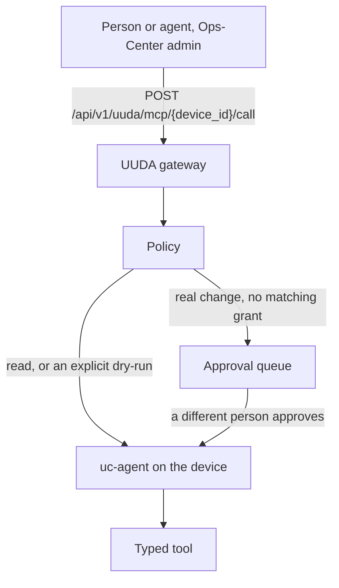
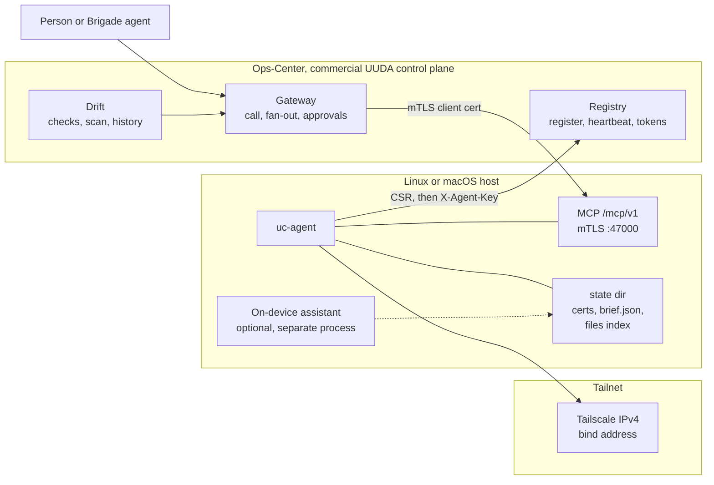

<p align="center">
  <strong>UUDA</strong><br>
  Uniform Unicorn Device Agent
</p>

<p align="center">
  A Rust daemon on each Linux or macOS machine. People and agents call typed tools over mutual TLS.
</p>

<p align="center">
  <a href="LICENSE-APACHE"></a>
  <a href="agent/Cargo.toml"></a>
  <a href="agent/rust-toolchain.toml"></a>
  <a href="#built-for-agents"></a>
  
  
</p>

<p align="center">
  <a href="#quick-start">Quick start</a> ·
  <a href="#features">Features</a> ·
  <a href="#built-for-agents">Agents</a> ·
  <a href="#architecture">Architecture</a> ·
  <a href="#part-of-unicorn-commander">Suite</a>
</p>

The crates in this repository are version **0.2.0**. [CHANGELOG.md](CHANGELOG.md) records that release (2026-06-25) and later unreleased work that is still on the same version.



<p align="center"><em>A tool call through the commercial control plane. Reads run. A real change waits unless a scoped grant allows it, and the requester cannot approve their own action.</em></p>

## What is UUDA?

UUDA is the device agent for a fleet you run yourself. `uc-agent` is one binary. It registers with the UUDA control plane, heartbeats, and serves a typed [MCP](https://modelcontextprotocol.io) tool surface over mutual TLS on that machine's tailnet address.

You use it on Linux and macOS servers and workstations. Phones, tablets, and mobile-device management are outside what this agent does. The daemon never calls a model. An assistant you run on the workstation, if you run one, picks up a brief from disk. Fleet callers reach the device through the commercial control plane that ships with [Ops-Center](https://github.com/Unicorn-Commander/Ops-Center): registry, policy, audit, and the gateway. That plane is proprietary and is the part of the product that holds a mutating call for a human.

## Features

- **Eighteen typed tools** on one mTLS listener, so a caller asks for `system.health` or `package.install` instead of a shell session.
- **Preview by default** on `package.install` and `messages.send`. Through the gateway, a real change is queued until someone else approves it, unless a scoped grant says otherwise.
- **Fleet probes with a deadline.** `disk.smart`, `zfs.status`, `update.status`, and `container.images` are read-only. Each external command times out (20 seconds unless the caller sets a lower or higher bound, hard cap 300 seconds).
- **Headless and squad, same binary.** Servers leave `has_local_agent` off. A workstation can store a brief for an on-device assistant and report that assistant's last status.
- **Opt-in file search** (SQLite FTS5) and, on macOS only, an opt-in Messages bridge. Both stay off until the config turns them on.
- **A small on-device footprint for identity.** The process generates a key, sends a CSR, and stores the signed certificate, the CA chain, and an agent key. Heartbeats send that key and retry from a queue of 1,000 if the control plane blips.
- **Install paths that match the service manager.** `agent/install.sh` lays down systemd or launchd. A `.deb` can be built from a Linux binary and deliberately does not start the service.

### Registration and heartbeat

On first start, with no `registration.toml` yet, the agent builds a CSR, posts it to `{control_plane.base_url}/api/v1/uuda/register` with the bootstrap token, and writes `cert.pem`, `key.pem`, and `ca-chain.pem`. After that it heartbeats `device_id`, `agent_version`, and uptime to `/api/v1/uuda/heartbeat` with header `X-Agent-Key`. The default interval is 30 seconds. The listener binds to `tailscale ip --4` unless `UC_AGENT_LISTEN_IP` is set, on port **47000**.

The whole listener, including `GET /healthz` and `GET /version`, requires a client certificate chained to the UUDA CA. A curl with no certificate fails in the handshake.

### Health, metrics, logs, and service status

`system.health` returns uptime, load, memory, disks, and CPU temperature when the host exposes it. `system.metrics` serves a 1 Hz ring buffer: the default window is 300 seconds, the maximum window is 3600, and series are capped at 500. `system.logs` reads the systemd journal for a unit on Linux, and `log show` by subsystem on macOS (default 200 lines, hard cap 10,000). `service.status` asks systemd or launchd for state, enabled flag, pid, and a short log tail. These four are read-only.

```bash
curl --cert <client-cert>.pem --key <client-key>.pem --cacert <ca-chain>.pem \
  -H 'content-type: application/json' \
  -H 'accept: application/json, text/event-stream' \
  -d '{"jsonrpc":"2.0","id":1,"method":"tools/call","params":{"name":"system.health","arguments":{}}}' \
  "https://<device-host>:47000/mcp/v1"
```

### Packages, with a dry-run default

`package.install` plans an install through Homebrew on macOS when `brew` is on the machine, or through `apt-get` on Linux when `/usr/bin/apt-get` exists. On the device, `dry_run` defaults to **true**, so a call that omits it returns a change set and does not install. Pass the boolean `false` to apply. The gateway treats a missing `dry_run` as a real change and holds it; see [Built for agents](#built-for-agents).

```json
{ "name": "package.install", "arguments": { "name": "<package>", "dry_run": true } }
```

`backend` accepts `auto`, `apt`, or `brew`.

### Disks, ZFS, updates, and containers

These four observers are safe to run on a sick host because they cannot hang the agent past their deadline, and they do not repair anything.

| Tool | What it reports | When the tool is absent |
|---|---|---|
| `disk.smart` | Per-disk SMART raw counters. Status comes from those counters. The overall PASSED/FAILED bit is reported beside them and is not an input. | `smartctl_available: false` off Linux |
| `zfs.status` | Pool capacity, vdev errors, scrub state, and `suspended` as its own flag. It runs `zpool list` and `zpool status` only. | `zfs_available: false` |
| `update.status` | Apt list age, upgradable and security counts, last unattended-upgrades result, who holds the dpkg lock and for how long, D-state processes, reboot-required, held packages. | `apt_available: false` off Debian/Ubuntu |
| `container.images` | Local Docker containers: tag, digest, age, restart policy, whether it is restarting now, health. It does not contact a registry. | `docker_available: false` |

### Squad mode: briefs without a model in the daemon

`agent.has_local_agent` defaults to false. `agent.report` then returns `has_local_agent: false` and does not invent a status. Set it true on a workstation and the same binary stores briefs at `{state_dir}/brief.json`. `agent.brief` writes the prompt, context, and tasks. `agent.report` reads the last brief plus `{state_dir}/report.json`, which the on-device assistant writes. `uc-agent` does not start that assistant.

Through the gateway, `agent.brief` is a real mutation: it has no dry-run flag, so the call is held for approval unless a grant covers it.

### File search, off until you enable it

`files.search`, `files.index`, and `files.status` use a local SQLite FTS5 index at `{state_dir}/files_index.db`. Nothing is indexed until `files_enabled` is true (or `UC_FILES_ENABLED` is `1`, `true`, `yes`, or `on`) and at least one root is set (`files_roots`, or `UC_FILES_ROOTS` as a colon- or comma-separated list). Search sanitizes the FTS5 query and returns an empty result for a bad query. `files.index` writes the index. The gateway classifies it as a real mutation.

### macOS Messages, off until you enable it

`messages.list`, `messages.thread`, and `messages.poll` read `~/Library/Messages/chat.db` (override with `messages_db_path`). `messages.send` drives the Messages app. `dry_run` defaults to true and returns a change set without sending. The tools return permission-denied until `messages_enabled` is true. They need macOS Full Disk Access and Automation consent for the user whose database you point at. A root daemon should set `messages_db_path` at that user's home.

## Built for agents

`uc-agent` is an MCP server. Suite agents do not dial it anonymously. They call the gateway in the commercial control plane, and the gateway dials the device.

**On the device**

| | |
|---|---|
| Transport | MCP Streamable HTTP, stateless, JSON responses (protocol `2024-11-05`) |
| URL | `https://<device-tailnet-ip>:47000/mcp/v1` |
| Auth | TLS client certificate chained to the UUDA CA issued at registration |
| Also on that listener | `GET /healthz`, `GET /version` (same mTLS requirement) |

Stateless mode accepts a bare `tools/call` with no `initialize` session. That is the call the gateway sends. A session-oriented client can still speak `initialize` and `tools/list`; `test/harness/mcp_probe.py` does.

The eighteen tools, by name:

`system.health` · `system.metrics` · `system.logs` · `service.status` · `package.install` · `agent.brief` · `agent.report` · `disk.smart` · `zfs.status` · `update.status` · `container.images` · `files.search` · `files.index` · `files.status` · `messages.list` · `messages.thread` · `messages.poll` · `messages.send`

There is no separate agent-to-agent endpoint in this repository. Call MCP on the device, or call the gateway.

**Through the control plane**

The gateway lives in Ops-Center. Admin authentication is the host application's check. In the Unicorn Commander suite that check is the existing sign-in. This repository does not implement that login. The local harness stubs it with an `X-Uuda-Actor` header so two different people can be simulated. Do not send that header to a production Ops-Center and expect it to mean anything.

| Method and path | Body | Effect |
|---|---|---|
| `POST /api/v1/uuda/mcp/{device_id}/call` | `{ "tool", "arguments" }` | One tool on one device, after policy |
| `GET /api/v1/uuda/mcp/{device_id}/tools` | | `tools/list` on that device |
| `POST /api/v1/uuda/mcp/fanout` | `{ "tool", "arguments", filters }` | The same tool on every matching device that policy allows. A real mutation is reported as blocked, not queued. |
| `GET /api/v1/uuda/mcp/approvals` | | The queue |
| `POST /api/v1/uuda/mcp/approvals/{id}/approve` | | Runs a held action. The requester is rejected. |
| `POST /api/v1/uuda/mcp/approvals/{id}/reject` | | Drops a held action |

Policy classes in that plane are `read`, `mutating`, `destructive`, and `escape_hatch`. Unknown tool names are `mutating`. A name that looks like a shell, a delete, or a shutdown is `escape_hatch` and denied unless a grant sets `allow_escape`. Reads run. An explicit `dry_run: true` on `package.install` or `messages.send` runs as a preview. Any other mutating call is held until a different person approves it, unless a grant with `auto_approve` matches that actor and that device. A fully wildcard elevating grant is ignored. Fan-out refuses a set larger than **250** devices. The request field `max_devices` can only lower that cap (it defaults to 100).

Org fencing is off until Ops-Center sets `UUDA_TENANCY_ENFORCED`. While it is off, a caller who passes the admin check can see every device. While it is on, a device outside the caller's orgs is a 404.

Direct mTLS to the agent does not consult this queue. A client that already holds a device certificate is inside the trust boundary the CA drew. Put fleet agents on the gateway if you want the approval step.

```bash
# Device, mutual TLS, stateless tools/call. Preview of a package install.
curl --cert <client-cert>.pem --key <client-key>.pem --cacert <ca-chain>.pem \
  -H 'content-type: application/json' \
  -H 'accept: application/json, text/event-stream' \
  -d '{"jsonrpc":"2.0","id":1,"method":"tools/call","params":{"name":"package.install","arguments":{"name":"<package>","dry_run":true}}}' \
  "https://<device-host>:47000/mcp/v1"
```

```bash
# Gateway. Ops-Center must already accept the caller as an admin.
# Omitting dry_run here is a real change and is held for approval.
curl -H 'content-type: application/json' \
  -d '{"tool":"system.health","arguments":{}}' \
  "https://<ops-center>/api/v1/uuda/mcp/<device-id>/call"
```

```json
{
  "mcpServers": {
    "uuda-device": {
      "url": "https://<device-host>:47000/mcp/v1"
    }
  }
}
```

That JSON is the URL shape only. The handshake still requires the client certificate, key, and CA. A client that can only send a bearer token to a URL cannot open this listener. Point fleet agents at the gateway, and keep the certificate on the gateway.

`test/harness/mcp_probe.py` is a working client for the device:

```bash
python3 test/harness/mcp_probe.py \
  --base https://<device-host>:47000 \
  --cert <client-cert>.pem \
  --key <client-key>.pem \
  --ca <ca-chain>.pem
```

## Quick start

`uc-agent` will not serve tools until it has registered and written its certificates. There is no flag that skips registration. You need:

- Rust **1.88** (pinned in [`agent/rust-toolchain.toml`](agent/rust-toolchain.toml)), `protoc`, and a C compiler. `rusqlite` builds SQLite, and `uc-types` generates code from [`proto/`](proto/) during `cargo build`.
- For a real machine: the Tailscale CLI, connected (`tailscale ip --4`), root, and a single-use bootstrap token from the UUDA control plane in Ops-Center.
- An Ops-Center base URL you pass yourself. Always pass `--base-url`. The install script contains a built-in default that is not a public address.

The commercial control plane is what issues the token and signs the CSR. It ships with Ops-Center. This page does not document that source tree.

### Docker harness

[`test/harness/`](test/harness/README.md) is the loop this repository can stand up in Docker: Postgres, a small API process, and a Linux build of `uc-agent`. The compose file bind-mounts the commercial control-plane routers. If that tree is not in the checkout, `docker compose` fails on the missing mounts, and the path below is the one that still works.

On a Linux host, build the target that matches the machine (`x86_64-unknown-linux-gnu` or `aarch64-unknown-linux-gnu`, both listed in the toolchain file). [`agent/.cargo/config.toml`](agent/.cargo/config.toml) sets the x86_64 Linux linker to `x86_64-linux-gnu-gcc`.

```bash
cd agent
cargo build --release --target x86_64-unknown-linux-gnu -p uc-agent
cd ../test/harness
./smoke.sh
```

From macOS, the cross build the harness expects is `cargo zigbuild` after `cargo install cargo-zigbuild`, for `aarch64-unknown-linux-gnu` or `x86_64-unknown-linux-gnu`. `./smoke.sh` looks the binary up through `cargo metadata` and tells you the exact path if it is missing. `./smoke.sh --keep` leaves the stack up. `./smoke-full.sh` drives the governed loop (dry-run, hold, separation of duties, drift, remediation) against that stack. `./smoke.sh --down` tears it down.

The harness publishes the API on `127.0.0.1:18084` and the agent on `127.0.0.1:47000`. It does not run Keycloak. Identity on those calls is the `X-Uuda-Actor` header.

### Install on a machine

Build a native binary, then install. Run the script from a root shell. It refuses to continue without the Tailscale CLI.

```bash
cd agent
cargo build --release -p uc-agent
sudo ./install.sh \
  --binary ./target/release/uc-agent \
  --token <bootstrap-token> \
  --tier prod \
  --owner <owner> \
  --base-url https://<ops-center-host>
```

That copies the binary to `/usr/local/libexec/uc-agent`, writes `/etc/uc-agent/config.toml`, creates `/var/lib/uc-agent` and `/var/lib/uc-agent/certs`, installs the systemd unit or the launchd plist `tech.magicunicorn.uc-agent`, and starts the service. On Linux, if ufw or firewalld is already active, it allows TCP 47000 from the tailnet interface.

`tier` and `owner` are stored as tags on the device. The harness uses `dev` and `harness`. Use values your control plane expects.

Skip the start with `UC_AGENT_NO_START=1` if you want to edit the config first. Logs: `journalctl -u uc-agent` on Linux, `/var/log/uc-agent.log` on macOS.

```bash
sudo ./install.sh --uninstall
```

Uninstall stops the service and removes the binary, `/etc/uc-agent`, and `/var/lib/uc-agent`. It leaves the machine on the tailnet.

## Run from source

The same toolchain as the quick start. From `agent/`:

```bash
cargo fmt --check
cargo clippy --workspace --all-targets
cargo test --workspace
cargo build --release -p uc-agent
```

The workspace is three crates: `uc-types` (generated from `proto/uc/v1`), `uc-toolkit` (the tool implementations), and `uc-agent` (the daemon). Edition 2021. Release builds use thin LTO, one codegen unit, and `panic = abort`.

To run the binary you still need a config file and a control plane that will accept the CSR. Copy [`agent/packaging/config.example.toml`](agent/packaging/config.example.toml) and replace `control_plane.base_url`. The sample value in that file is not a public endpoint.

```toml
[agent]
mcp_port = 47000
heartbeat_interval = "30s"
register_timeout = "30s"
has_local_agent = false

[control_plane]
base_url = "https://<ops-center-host>"
tls_skip_verify = false

[paths]
state_dir = "/var/lib/uc-agent"
cert_dir = "/var/lib/uc-agent/certs"

[bootstrap]
token = "<bootstrap-token>"
tier = "dev"
owner = "<owner>"
```

```bash
export UC_AGENT_CONFIG=./config.toml
# Lab only: bind without asking Tailscale. A normal install should not set this.
export UC_AGENT_LISTEN_IP=127.0.0.1
export UC_AGENT_HOSTNAME=lab-node
./target/release/uc-agent
```

`UC_AGENT_LISTEN_IP` does not skip registration. On a first start, with no `registration.toml` yet, the process exits if the token is empty or the control plane rejects the CSR.

There is no `.env` file and no Makefile. Configuration is the TOML file plus the variables below.

## Configuration

Names only. Put secrets in the config file the installer writes (mode `0640`) or in the environment of the install command. Do not commit them.

| Variable or key | Meaning |
|---|---|
| `control_plane.base_url` | Required. Ops-Center origin the agent uses for `/api/v1/uuda/register` and `/heartbeat`. Must be an `http` or `https` URL. |
| `control_plane.tls_skip_verify` | Skip TLS verification on those two calls. Default `false`. Leave it false against a real certificate. |
| `bootstrap.token` | Single-use registration token. The agent refuses to register when it is empty. |
| `bootstrap.tier`, `bootstrap.owner` | Tags sent at registration. |
| `agent.mcp_port` | mTLS listen port. Default `47000`. |
| `agent.heartbeat_interval` | Default `30s`. |
| `agent.register_timeout` | Timeout for the registration POST. Default `30s`. |
| `agent.has_local_agent` | Squad mode. Default `false`. When false, `agent.report` says there is no on-device assistant. |
| `agent.messages_enabled`, `agent.messages_db_path` | macOS Messages bridge. Default off. |
| `agent.files_enabled`, `agent.files_roots` | File index. Default off, no roots. |
| `paths.state_dir`, `paths.cert_dir` | Registration file, briefs, file index, and PEM files. |
| `UC_AGENT_CONFIG` | Config path. Default `/etc/uc-agent/config.toml`. |
| `UC_AGENT_BASE_URL` | Installer override for `control_plane.base_url`. Prefer `--base-url`. |
| `UC_AGENT_TOKEN`, `UC_AGENT_TIER`, `UC_AGENT_OWNER` | Installer equivalents of `--token`, `--tier`, `--owner`. |
| `UC_AGENT_BINARY`, `UC_AGENT_DOWNLOAD_URL` | Where `install.sh` gets the binary. One of them is required. |
| `UC_AGENT_NO_START` | `1` installs the unit and does not start it. |
| `UC_AGENT_LISTEN_IP` | Bind this IPv4 address instead of `tailscale ip --4`. |
| `UC_AGENT_HOSTNAME` | Hostname sent at registration, instead of the `hostname` command. |
| `UC_FILES_ENABLED`, `UC_FILES_ROOTS` | Override the file-index flag and roots. Roots are colon- or comma-separated. |
| `RUST_LOG` | Tracing filter. The units default it to `info`. The process logs JSON to stderr. |
| `UUDA_TENANCY_ENFORCED` | Control plane. Off by default. On, devices outside the caller's orgs are invisible. |
| `UUDA_DRIFT_SCAN_ENABLED` | Control plane. Off by default. The periodic drift scan never runs a remediation tool. |

`tls_skip_verify` and the two `UUDA_*` switches are the ones that change safety defaults. The drift scheduler and the org fence ship off.

## Architecture



| Piece | Role |
|---|---|
| `uc-agent` | Daemon. Registration, heartbeat, mTLS listener, tool router. |
| `uc-toolkit` | Tool code: health, logs, packages, services, probes, files, messages, briefs. External commands go through a timed executor with stdin from `/dev/null`. |
| `uc-types` | Rust types generated from `proto/uc/v1` at build time (`prost` and `pbjson`). |
| `proto/uc/v1` | Wire schema shared with the control plane: errors, registration and heartbeat, and the original tool messages. Package `uc.v1`. |
| Gateway, policy, drift | Commercial, inside Ops-Center. Device inventory, the approval queue, org fencing, desired-state checks. The scan loop is read-only and off until enabled. |
| Tailscale | The address the agent binds, and the path the gateway dials. `install.sh` will not run until `tailscale ip --4` works. |
| On-device assistant | Not in this repository. It reads `brief.json` and writes `report.json` when squad mode is on. |

A `.deb` ([`agent/packaging/build-deb.sh`](agent/packaging/build-deb.sh)) and a macOS sign-and-notarize script ([`agent/packaging/sign-macos.sh`](agent/packaging/sign-macos.sh)) sit next to the systemd unit and the launchd plist. The package does not start the service, because a start with an empty token only burns the restart budget.

## Part of Unicorn Commander

| App | What it does |
|---|---|
| [Ops-Center](https://github.com/Unicorn-Commander/Ops-Center) | The control plane: tenants, billing, federation, API keys, model routing |
| [Unicorn-Brigade](https://github.com/Unicorn-Commander/Unicorn-Brigade) | The agent layer: agents, tools, memory, orchestration |
| [Unicorn-Stable](https://github.com/Unicorn-Commander/Unicorn-Stable) | Humans and agents in the same room: chat, voice, video |
| [Accounting-Ops](https://github.com/Unicorn-Commander/Accounting-Ops) | Agent-native accounting and books |
| [Contact-Ops](https://github.com/Unicorn-Commander/Contact-Ops) | The shared contact and identity graph |
| [Customer-Ops](https://github.com/Unicorn-Commander/Customer-Ops) | Customers, pipeline, quotes and outreach |
| [Email-Ops](https://github.com/Unicorn-Commander/Email-Ops) | Agent-drafted email with a human approval inbox |
| [Project-Ops](https://github.com/Unicorn-Commander/Project-Ops) | Projects, tasks, time and invoices |
| [Meeting-Ops](https://github.com/Unicorn-Commander/Meeting-Ops) | Recordings, transcripts, summaries and action items |
| [Knowledge-Ops](https://github.com/Unicorn-Commander/Knowledge-Ops) | The wiki and memory your agents ground on |
| [Security-Ops](https://github.com/Unicorn-Commander/Security-Ops) | Authorized security scanning with engagement and attestation gates |
| [Tax-Planning-Ops](https://github.com/Unicorn-Commander/Tax-Planning-Ops) | Tax plans, scenarios and statutory deadlines |
| [Brand-Ops](https://github.com/Unicorn-Commander/Brand-Ops) | Brand kits, marks, voices and rules |
| [Podcast-Ops](https://github.com/Unicorn-Commander/Podcast-Ops) | Episodes, audio QA and publishing |
| **[UUDA](https://github.com/Unicorn-Commander/UUDA)** | **The device agent for your fleet** |
| [fleet-map](https://github.com/Unicorn-Commander/fleet-map) | Fleet inventory and topology map |

`uc-agent` registers and heartbeats to the UUDA control plane inside Ops-Center, and that plane's gateway is how an operator or a Unicorn Brigade agent invokes a tool on a device. This repository does not call the other suite applications.

## Development

Continuous integration is [`.forgejo/workflows/ci.yml`](.forgejo/workflows/ci.yml). The agent job installs `protoc` and a C compiler if they are missing, then runs:

```bash
cd agent
cargo fmt --check
cargo clippy --workspace --all-targets
cargo test --workspace
```

The workspace defines 77 Rust test functions. The same workflow has a Python job for the commercial control plane (154 test functions) which runs only when that tree is present.

Linux packages, from an already built binary:

```bash
agent/packaging/build-deb.sh --arch amd64 --binary <path-to-uc-agent>
agent/packaging/build-deb.sh --arch arm64 --binary <path-to-uc-agent>
```

Omit `--version` and the script reads `version` from `agent/Cargo.toml`. `UC_DEB_VERSION` is the environment form of that flag. Output goes to `dist/` unless you pass `--out`.

macOS signing reads `UC_SIGN_IDENTITY` and either `UC_NOTARY_PROFILE` or the `UC_NOTARY_APPLE_ID`, `UC_NOTARY_TEAM_ID`, and `UC_NOTARY_PASSWORD` trio. With none of those set, [`agent/packaging/sign-macos.sh`](agent/packaging/sign-macos.sh) exits in preflight and does not modify the binary.

Wire changes belong in `proto/uc/v1`. Rebuild so `uc-types` regenerates. Do not hand-edit generated sources. See [CONTRIBUTING.md](CONTRIBUTING.md).

## Security

Report a vulnerability privately to **security@magicunicorn.tech**. Please do not file a public issue for it. Details and what the running agent actually enforces are in [SECURITY.md](SECURITY.md).

## Licence

The agent (`agent/`) and the protocol (`proto/`) are [Apache License 2.0](LICENSE-APACHE).

The control plane is commercial software that ships with Unicorn Commander's Ops-Center, under the proprietary terms in [LICENSE-PROPRIETARY](LICENSE-PROPRIETARY). It is a separate product from the agent and protocol published here.

<p align="center">
  Built by <a href="https://magicunicorn.tech">Magic Unicorn</a> · part of <a href="https://unicorncommander.ai">Unicorn Commander</a>
</p>
